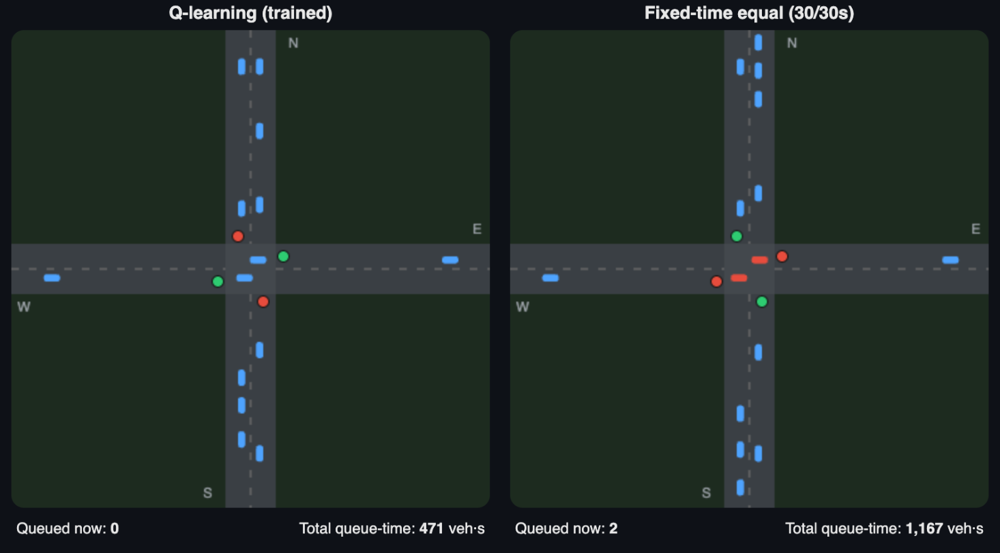

# Adaptive Traffic Signal Control with Q-Learning

A reinforcement-learning agent that controls a traffic-light intersection in the
[SUMO](https://eclipse.dev/sumo/) traffic simulator — deciding in real time whether to **hold** or
**switch** the green phase based on live queue lengths.

**Result: 63.7% less queuing than naive fixed timing, and 58% less than a demand-tuned fixed plan**,
with identical vehicle throughput — evaluated on 10 held-out random seeds.


## Live demo

**[adaptive-traffic-signal-rl.streamlit.app](https://adaptive-traffic-signal-rl.streamlit.app/)** (no install needed; if it has been idle, it takes about 30 seconds to wake up)

The same simulated traffic, two controllers. Red cars are stopped; watch the *total queue-time*
counters diverge:



The demo also includes a **policy explorer** — set up any traffic situation and inspect exactly
what the trained agent would do and why (the whole "brain" is a 39-state lookup table, so every
decision is fully inspectable).

## The problem

Fixed-time signals give every direction a pre-set green on a repeating cycle, blind to actual
traffic. Where a busy road (400 veh/h per direction) crosses a quieter one (200 veh/h), that wastes
green time on empty lanes while queues build on the busy approach. The agent instead observes the
queues every 5 seconds and learns *when switching is worth the 3-second yellow penalty* — including
beating a fixed plan that was already tuned to the correct 2:1 demand ratio.

## Results

| Controller | Avg wait/step | Mean travel time (s) | Completed trips |
|---|---|---|---|
| **Q-learning (trained)** | **5.31 ± 0.07** | **37.71 ± 0.13** | 1190.3 |
| Fixed-time equal (30/30s) | 14.64 ± 0.24 | 43.94 ± 0.23 | 1190.0 |
| Fixed-time proportional (40/20s) | 12.66 ± 0.18 | 42.12 ± 0.18 | 1190.6 |

*(mean ± std across 10 evaluation seeds never seen during training)*

## How it works, briefly

- **State** — halted-vehicle count per approach, discretized into 4 buckets, plus the current green
  phase: at most 512 states, ~39 visited in practice.
- **Actions** — `keep` or `switch` (honoured only after 10 s minimum green; switching always passes
  through a 3 s yellow).
- **Reward** — minus the accumulated queue length since the last decision.
- **Algorithm** — tabular Q-learning with ε-greedy exploration, trained for 300 simulated hours of
  traffic (about 2.5 minutes of wall-clock time).

The notebooks walk through the design, the training run and the evaluation step by step.

## Run it yourself

**Demo app only** (no SUMO needed — it replays precomputed simulation traces):

```bash
pip install -r requirements.txt
streamlit run streamlit_app.py
```

**Full pipeline** (train + evaluate + regenerate traces; needs SUMO):

```bash
python -m venv .venv && source .venv/bin/activate
pip install -r requirements.txt eclipse-sumo traci sumolib matplotlib jupyter
jupyter lab            # run 01_train_qlearning_agent.ipynb, then 02_evaluate_and_compare.ipynb
python scripts/generate_traces.py   # refresh the demo app's replay data
```

## Repository map

```
01_train_qlearning_agent.ipynb   builds the SUMO network, defines env + agent, trains, saves qtable.pkl
02_evaluate_and_compare.ipynb    benchmarks the agent vs. two fixed-time baselines on held-out seeds
streamlit_app.py                 the interactive demo (replay animation, results, policy explorer)
scripts/generate_traces.py       records per-second simulation traces for the demo's replay
app/traces/*.json.gz             precomputed replay data (committed so the app runs without SUMO)
app/replay.html                  the canvas/JS animation the app embeds
qtable.pkl                       the trained Q-table (the agent's entire "brain": ~2 KB)
```
